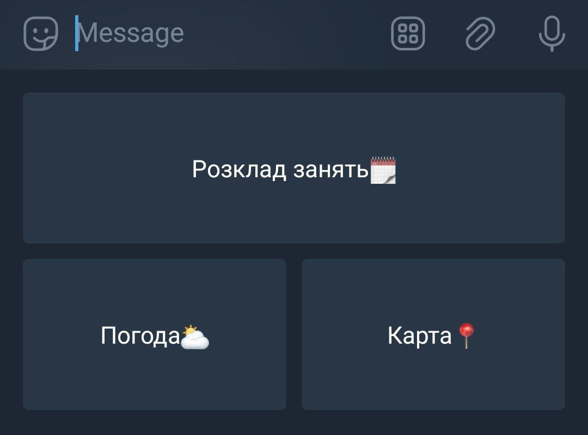
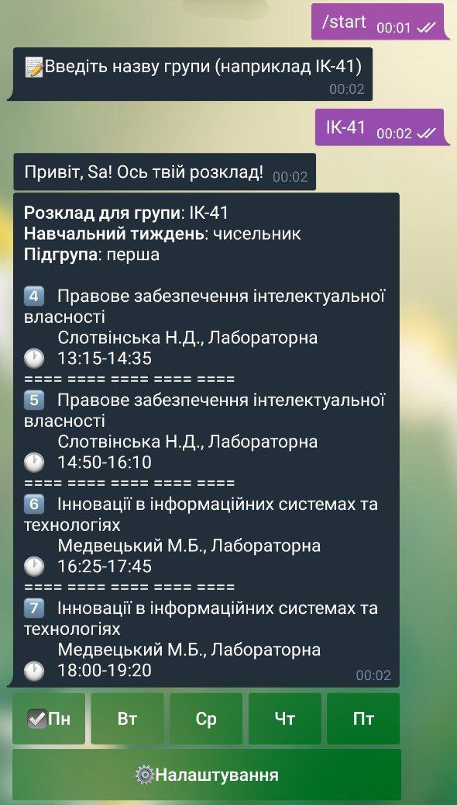
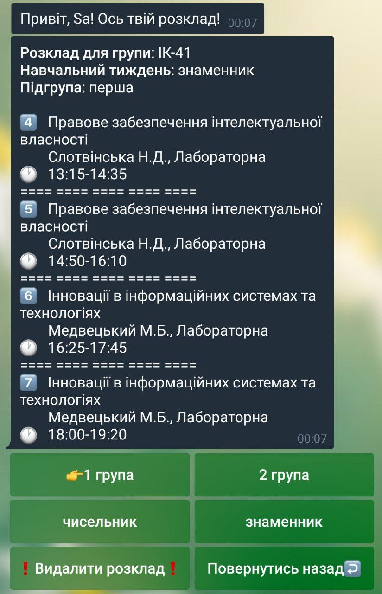
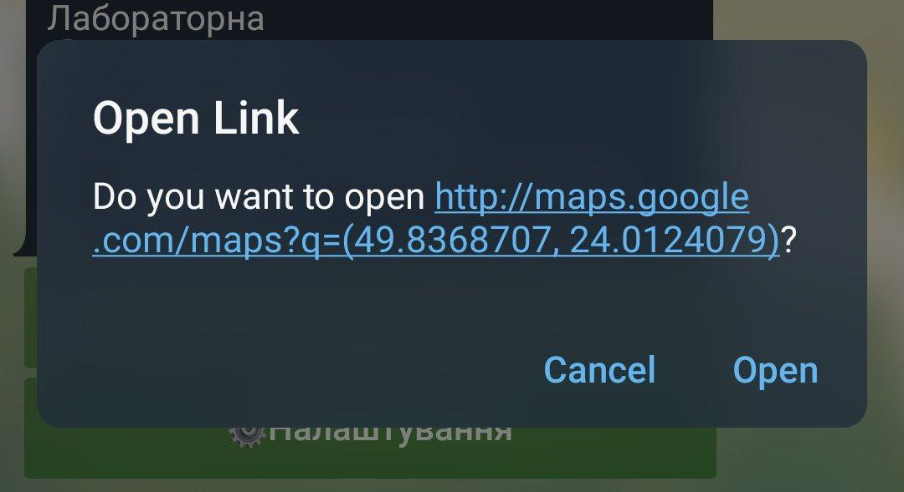
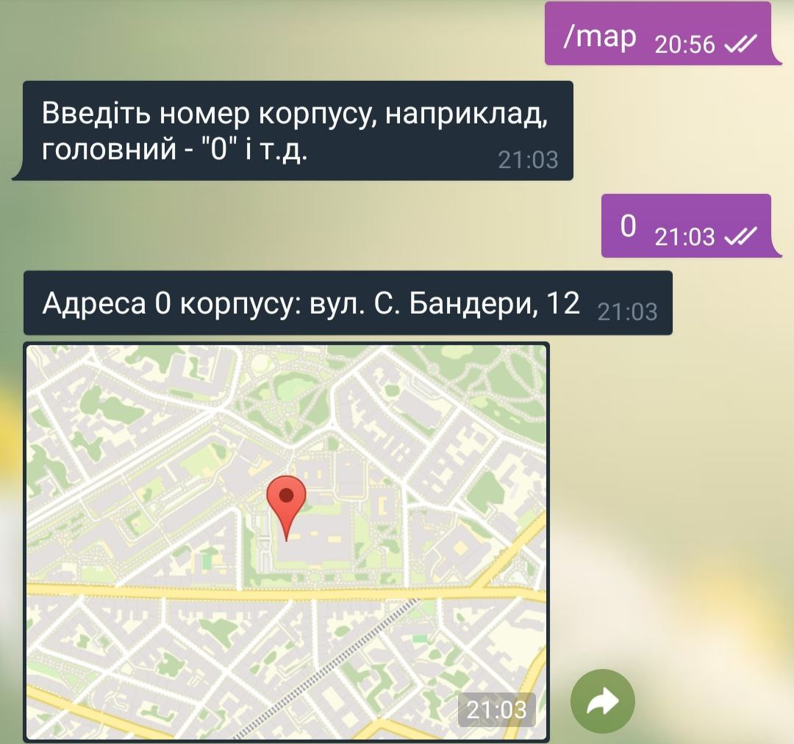
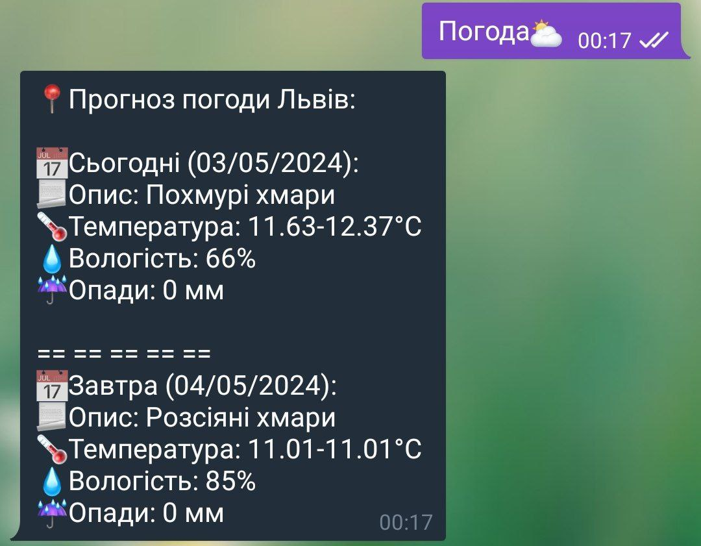

# 🎓 NULP ScheduleBot

<p align="center">
  <a href="README.md">🇺🇦 Українська</a> •
  <a href="README.en.md">🇬🇧 English</a>
</p>

[](https://www.python.org/)
[](https://core.telegram.org/bots)
[](https://www.crummy.com/software/BeautifulSoup/)
[](https://www.docker.com/)

**NULP ScheduleBot** — це багатофункціональний Telegram-бот для студентів **Національного університету «Львівська політехніка»**. Бот дозволяє отримувати актуальний розклад занять безпосередньо з офіційного сервісу розкладу, фільтрувати пари за днями, підгрупами та тижнями (чисельник/знаменник), знаходити корпуси на карті та дізнаватися прогноз погоди у Львові.

---

## ✨ Основні можливості

- 📅 **Актуальний розклад занять**:
  - Отримання даних у режимі реального часу з офіційного порталу [`student.lpnu.ua`](https://student.lpnu.ua/students_schedule).
  - Підтримка пошуку для будь-якої навчальної групи (наприклад, `ІК-41`, `ПЗ-21` тощо).
  - Гнучкі налаштування розкладу:
    - 🔘 Вибір дня тижня через зручні інлайн-кнопки (Пн–Пт).
    - 👥 Перемикання підгрупи (**1 група** / **2 група**).
    - 🔢 Перемикання навчального тижня (**Чисельник** / **Знаменник**).
    - 🕐 Відображення точного часу початку і завершення пар (від 1-ї до 8-ї).

- 📍 **Навігація по корпусах НУ «ЛП»**:
  - **Автоматичні геомітки у розкладі**: бот розпізнає номери корпусів у тексті розкладу (включаючи римські числа, наприклад `XXVII н.к.`) і додає клікабельне посилання 📍 з точними координатами на Google Maps.
  - **Пошук корпусу за номером**: команда `/map` або кнопка `Карта📍` дозволяє ввести номер корпусу (наприклад, `0`, `1`, `4`, `28` тощо) та миттєво отримати його текстову адресу і геопозицію через Telegram Location.

- ⛅️ **Прогноз погоди у Львові**:
  - Команда `/weather` або кнопка `Погода⛅️`.
  - Інтеграція з **OpenWeatherMap API**: температура (мін./макс.), опади, вологість та опис погоди на сьогодні і завтра.
  - Автоматичний переклад опису погоди на українську мову.

---

## 📸 Демонстрація роботи

| Головне меню бота | Отримання розкладу | Фільтри та налаштування |
| :---: | :---: | :---: |
|  |  |  |

| Посилання на Google Maps | Пошук корпусу за номером | Прогноз погоди |
| :---: | :---: | :---: |
|  |  |  |

---

## 📁 Структура проекту

```text
ScheduleBot/
├── demo-screenshots/              # Скріншоти роботи та інтерфейсу бота
├── project/
│   ├── convert_roman_numerals.py  # Розпізнавання та конвертація римських чисел для номерів корпусів
│   ├── corps_dataset.py           # База географічних координат та адрес корпусів НУ "ЛП"
│   ├── forecast.py                # Запити до OpenWeatherMap API та форматування прогнозу
│   ├── schedule_handler.py        # Парсинг HTML-сторінки розкладу НУ "ЛП" та формування розкладу
│   └── telegram_bot.py            # Основна логіка Telegram-бота, обробка команд та інлайн-меню
├── .env.example                   # Приклад конфігураційного файлу змінних середовища
├── .gitignore                     # Виключення тимчасових файлів та секретів з Git
├── Dockerfile                     # Специфікація для створення Docker-образу
├── docker-compose.yml             # Конфігурація для запуску через Docker Compose
├── main.py                        # Точка входу для запуску бота
└── requirements.txt               # Список необхідних Python-бібліотек
```

---

## 🛠 Технологічний стек

- **Мова програмування**: Python 3.12+
- **Фреймворк для Telegram**: [`python-telegram-bot`](https://github.com/python-telegram-bot/python-telegram-bot) (`v13.15`)
- **Парсинг сторінок**: [`BeautifulSoup4`](https://www.crummy.com/software/BeautifulSoup/) + [`requests`](https://requests.readthedocs.io/)
- **Погода**: [OpenWeatherMap API](https://openweathermap.org/api)
- **Переклад**: [`googletrans`](https://py-googletrans.readthedocs.io/)
- **Конфігурація**: [`python-dotenv`](https://github.com/theskumar/python-dotenv)
- **Контейнеризація**: Docker & Docker Compose

---

## 🚀 Встановлення та запуск

### 1. Клонування репозиторію

```bash
git clone https://github.com/sasha-1337/NULP-ScheduleBot.git
cd NULP-ScheduleBot
```

### 2. Налаштування змінних середовища

Створіть файл `.env` на основі `.env.example`:

```bash
cp .env.example .env
```

Відкрийте файл `.env` і заповніть ваші ключі:

```env
# Токен бота, отриманий у @BotFather в Telegram
TELEGRAM_TOKEN=your_telegram_bot_token_here

# API-ключ OpenWeatherMap (отримати безкоштовно на https://openweathermap.org/api)
OPENWEATHERMAP_API_KEY=your_openweathermap_api_key_here

# Місто для погоди (за замовчуванням Lviv)
CITY=Lviv
```

---

### Варіант А: Локальний запуск (Python)

1. **Створіть і активуйте віртуальне оточення**:
   - **Linux / macOS**:
     ```bash
     python3 -m venv venv
     source venv/bin/activate
     ```
   - **Windows (PowerShell)**:
     ```powershell
     python -m venv venv
     .\venv\Scripts\Activate.ps1
     ```

2. **Встановіть залежності**:
   ```bash
   pip install -r requirements.txt
   ```

3. **Запустіть бота**:
   ```bash
   python main.py
   ```

---

### Варіант Б: Запуск через Docker

1. **Збірка та запуск контейнера**:
   ```bash
   docker build -t nulp-schedulebot .
   docker run -d --name schedulebot --env-file .env nulp-schedulebot
   ```

2. **Або за допомогою Docker Compose**:
   ```bash
   docker-compose up -d --build
   ```

---

## 🤖 Команди та використання

| Команда / Кнопка | Опис |
| :--- | :--- |
| `/start` або `Розклад занять🗓` | Запуск діалогу з ботом, введення назви групи та отримання розкладу |
| `/map` або `Карта📍` | Запит адреси та надсилання геомітки корпусу (наприклад, `0` для головного, `1`, `4` тощо) |
| `/weather` або `Погода⛅️` | Отримання прогнозу погоди у Львові на сьогодні та завтра |
| `/cancel` | Скасування поточної операції/розмови з ботом |

### Інтерактивне меню розкладу
- **Дні тижня (`Пн`, `Вт`, `Ср`, `Чт`, `Пт`)**: миттєве перемикання розкладу для обраного дня.
- **⚙️ Налаштування**:
  - `1 група` / `2 група` — вибір підгрупи.
  - `чисельник` / `знаменник` — вибір типу навчального тижня.
  - `❗️Видалити розклад❗️` — скидання збережених параметрів розкладу.
  - `Повернутись назад↩️` — повернення до перегляду пар.

---

## 🔒 Безпека

> [!WARNING]
> Ніколи не публікуйте та не додавайте в систему контролю версій файл `.env` із вашими реальними токенами (`TELEGRAM_TOKEN`, `OPENWEATHERMAP_API_KEY`). Переконайтеся, що файл `.env` доданий до `.gitignore`.

---

## 👨‍💻 Автор

Розроблено для студентів Львівської політехніки: [@sasha-1337](https://github.com/sasha-1337).
